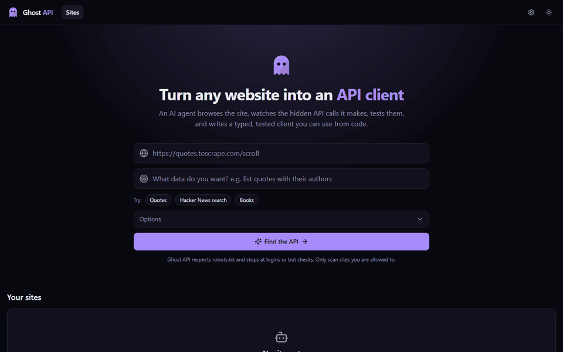
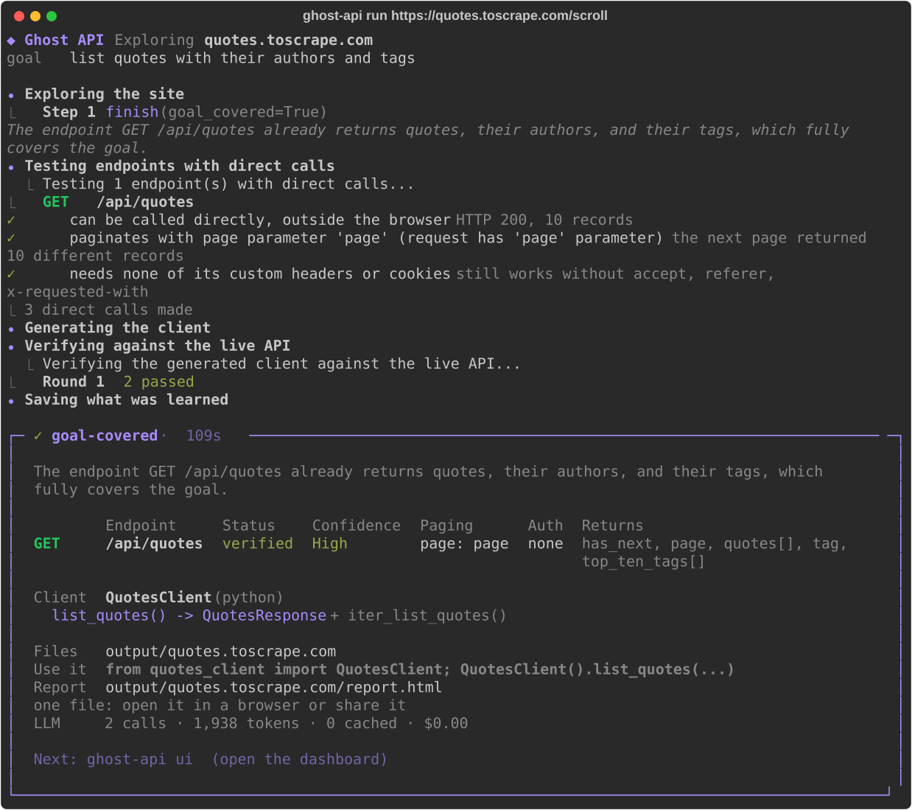
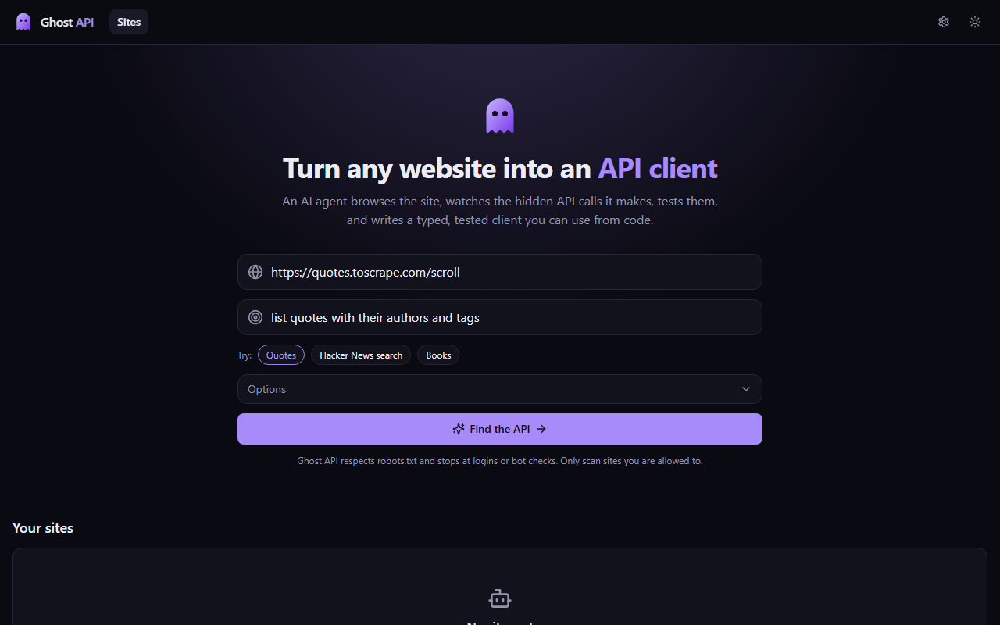
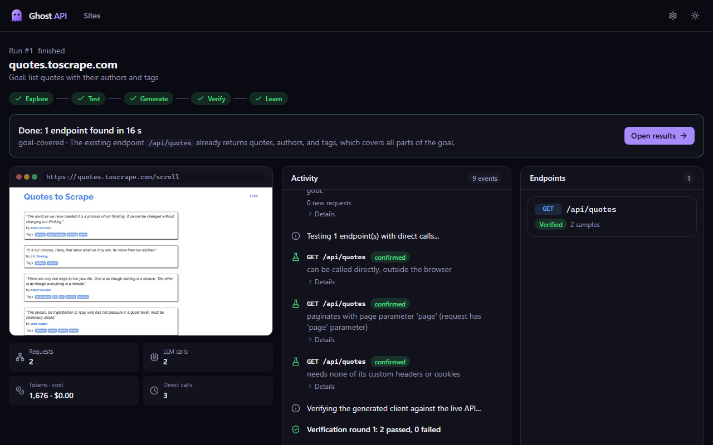
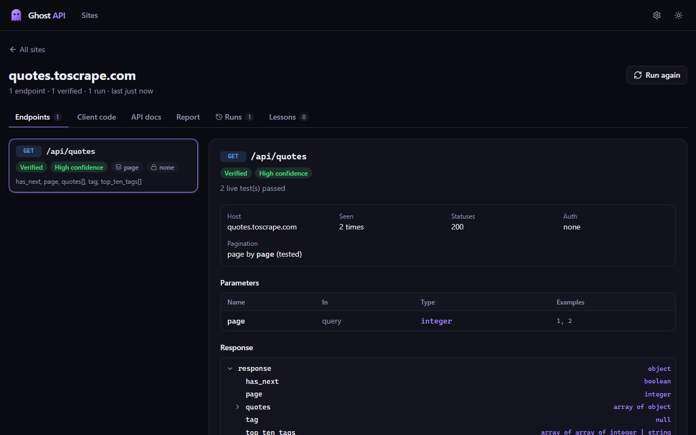
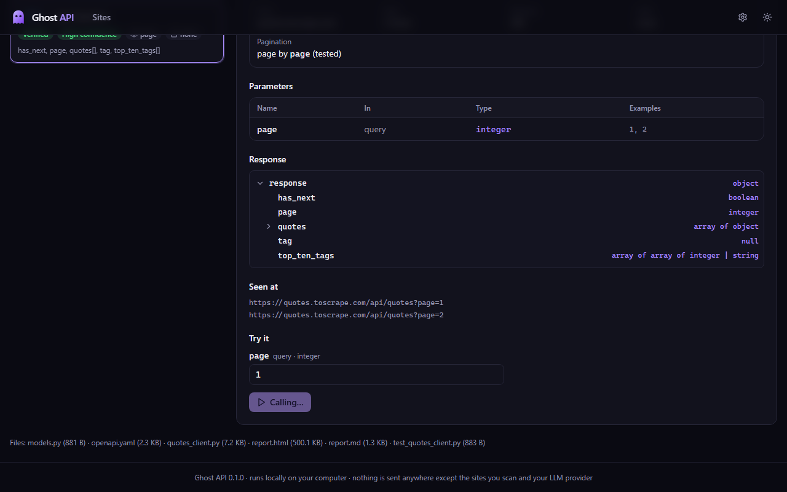
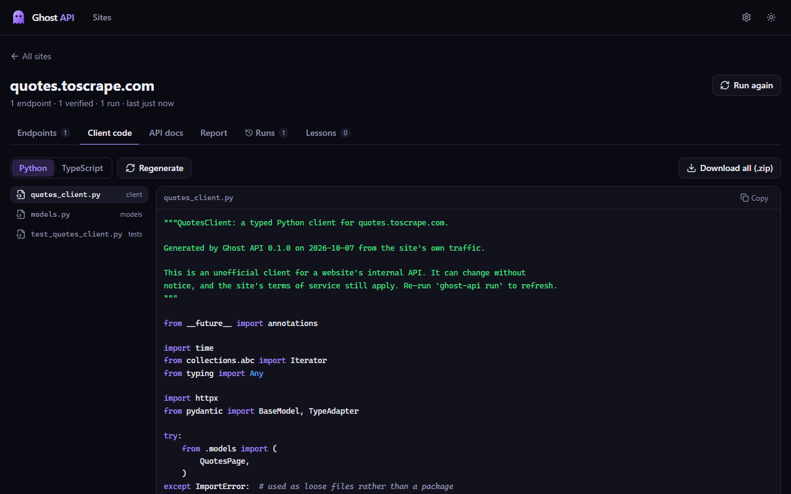
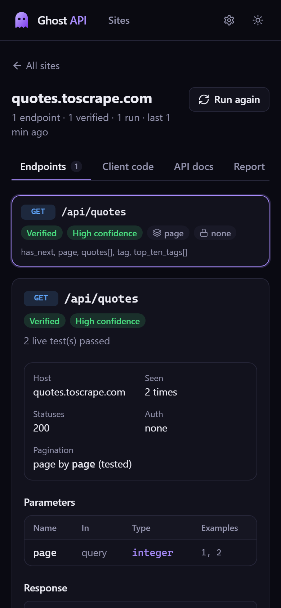
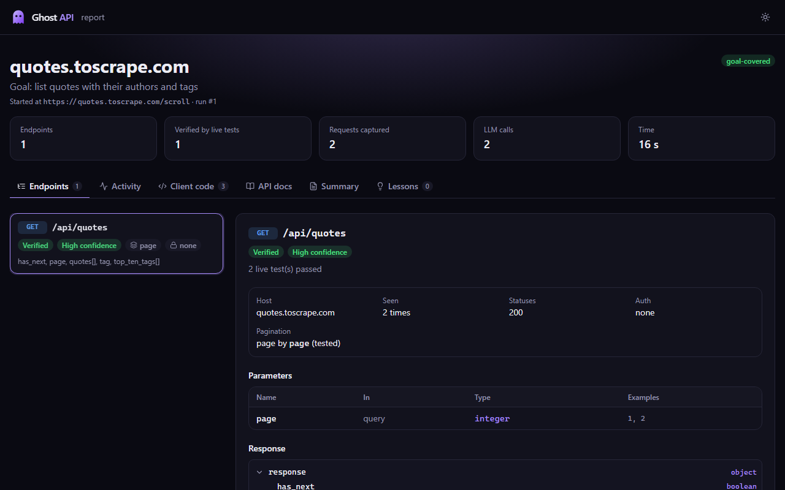

# Ghost API

**An AI agent that turns any website into a typed, tested API client.**

Give Ghost API a website and a plain-English goal. It opens the site in a real browser, watches the hidden requests the site makes to its own server, works out how that hidden API behaves, and writes a clean Python (or TypeScript) client library for it, with tests.



<sub>A real run on quotes.toscrape.com from the web dashboard (`ghost-api ui`): the agent loads the page, the API call is tested, a client is generated and verified, and "Try it" calls the endpoint. 2 free LLM calls, about 20 seconds.</sub>

> **Status:** Version 0.1.0. All 11 build stages are done and evaluated on four sites (see [Evaluation](#evaluation)): every goal endpoint found, nothing invented, every generated client test passing, for 1–10 free LLM calls per site. It has a live terminal UI, a local web dashboard and a shareable one-file HTML report. See [IMPLEMENTATION.md](IMPLEMENTATION.md) for how it was built.

---

## Table of contents

- [The simple explanation](#the-simple-explanation)
- [The problem](#the-problem)
- [What Ghost API does](#what-ghost-api-does)
- [Example](#example)
- [How it works](#how-it-works)
- [Why it's an agent, not a script](#why-its-an-agent-not-a-script)
- [Memory](#memory)
- [Features](#features)
- [Tech stack](#tech-stack)
- [Getting started](#getting-started)
- [What can I do with it?](#what-can-i-do-with-it)
- [Three ways to see the results](#three-ways-to-see-the-results)
- [Usage](#usage)
- [Output](#output)
- [Project structure](#project-structure)
- [Running on free LLM tiers](#running-on-free-llm-tiers)
- [Responsible use](#responsible-use)
- [Evaluation](#evaluation)
- [Limitations](#limitations)
- [Roadmap](#roadmap)

---

## The simple explanation

Picture a restaurant with **no menu**. You can eat there, but only by pointing at other people's plates. Behind the scenes, every time someone orders, the waiter hands the kitchen a neat order slip:

> "Table 4: 1x Pasta, no cheese, large."

The kitchen understands those slips perfectly. You just never see them.

**Ghost API sits in the restaurant, watches every order slip going to the kitchen, and writes the menu for you.** After that you can order directly, without pointing at plates.

| In the analogy | In real life |
|---|---|
| The restaurant | Any website (a bookstore, a weather site, a job board) |
| Pointing at plates | Copying data by hand, or fragile "scraper" programs that break when the design changes |
| The order slips | The hidden requests a website makes to its own server |
| The menu | A small code library that gets the data directly, cleanly and reliably |

**What makes it "AI":** Ghost API doesn't just record. Like a curious person, it:

1. **Explores** the site by clicking, searching and scrolling
2. **Notices patterns**, such as "every time I open a book, the site asks for `/books/<number>`"
3. **Tests its guesses**, such as "if I ask for page 2, do I get different results?"
4. **Fixes its mistakes** when a guess turns out wrong
5. **Remembers** what it learned, so next time is faster

---

## The problem

Almost every modern website loads its data through a **hidden internal API**. When you open a product page, your browser quietly calls something like:

```
GET https://shop.example.com/api/v2/products/123?include=reviews
-> { "id": 123, "name": "Blue Shoes", "price": 59.99, "reviews": [...] }
```

Developers often want that data in their own code. Their options today are poor:

| Approach | Why it's poor |
|---|---|
| Scrape the HTML | Breaks whenever the page layout changes, and is slow |
| Reverse-engineer by hand in browser DevTools | Takes hours: clicking around, copying requests, guessing what each field means |
| Tools like mitmproxy or Postman | Record raw traffic, but don't understand it or write any code |

No existing tool both **discovers** these hidden APIs and **produces working code** for them.

---

## What Ghost API does

| Input | Output |
|---|---|
| A website URL | A typed Python client library (`httpx` + `pydantic`) |
| A plain-English goal ("search books and get details") | A pytest test suite that runs against the live site |
| | An OpenAPI 3 spec |
| | A report showing what was found, how confident it is, and the agent's reasoning |

---

## Example

Real output from the practice site `quotes.toscrape.com/scroll` (abridged):

```
$ ghost-api run https://quotes.toscrape.com/scroll --goal "list quotes with their authors and tags"

Exploring site...
      GET 200 /api/quotes?page=1
Step 1 finish(goal_covered=True)  The discovered endpoint already returns quotes, their authors, and tags

Testing 1 endpoint(s) with direct calls...
  GET /api/quotes
    confirmed    can be called directly, outside the browser   HTTP 200, 10 records
    confirmed    paginates with page parameter 'page'          the next page returned 10 different records
    confirmed    needs none of its custom headers or cookies

Verifying the generated client against the live API...
  Round 1: 2 passed

Generated QuotesToscrapeClient in output/quotes.toscrape.com
   get_quotes() -> QuotesResponse  + iter_get_quotes()
```

The generated client:

```python
from quotes_toscrape_client import QuotesToscrapeClient

with QuotesToscrapeClient() as api:
    page = api.get_quotes()  # -> QuotesResponse (pydantic)
    print(page.quotes[0].author.name)  # nested models: Quote, Author
    for p in api.iter_get_quotes(max_pages=3):  # pagination handled for you
        ...
```

The same client in TypeScript (`--lang typescript`):

```ts
import { QuotesToscrapeClient } from "./quotes_toscrape_client.ts";

const api = new QuotesToscrapeClient();
const page = await api.getQuotes(); // Promise<QuotesResponse>
for await (const p of api.iterGetQuotes({ maxPages: 3 })) console.log(p.page);
```

A harder case: on `hn.algolia.com` the agent switched the search filter to "Comments", found
that the real API is a POST to Algolia's servers (a third-party domain), and the prober
confirmed that paging works in the JSON body and that the `x-algolia-api-key` URL parameter
is required (HTTP 403 without it). The client it generated:

```python
from hn_algolia_client import HnAlgoliaClient  # key from HN_ALGOLIA_X_ALGOLIA_API_KEY

with HnAlgoliaClient() as api:
    results = api.search_stories(index="Item_dev", query="python")  # -> SearchResults
```

---

## How it works

```
                         +---------------------+
                         |       START         |
                         |  URL + goal + lang  |
                         +----------+----------+
                                    v
                         +---------------------+
                         | 0. PRE-CHECKS       |
                         | robots.txt, memory  |---- known site? ---> load past
                         | lookup, budgets     |                      knowledge
                         +----------+----------+
                                    v
          +----------------------------------------------------+
          |                  AGENT LOOP                        |
          |   1. OBSERVE  page snapshot + captured traffic     |
          |   2. DECIDE   LLM picks: explore / test / ask /    |
          |               finish                               |
          |   3. ACT      run a tool (click, type, call API)   |
          |   4. LEARN    update endpoint map + schemas        |
          |   goal covered? budget left? --no--> back to 1     |
          +----------+-----------------------------------------+
                     | yes
                     v
          +---------------------+
          | 5. GENERATE CODE    | client + models + tests
          +----------+----------+
                     v
          +---------------------+      fail      +--------------+
          | 6. VERIFY (tests)   |--------------->| 7. DIAGNOSE  |--> back to
          +----------+----------+                | & REPLAN     |    agent loop
                     | pass                      +--------------+    (max 3x)
                     v
          +---------------------+
          | 8. SAVE MEMORY +    |
          |    WRITE REPORT     |
          +---------------------+
```

### Step by step

**0. Pre-checks.** It reads `robots.txt`, looks the domain up in memory, and sets budgets (maximum LLM calls, steps and minutes).

**1. Observe.** The agent gets a compact view of the page: the clickable elements and inputs with short IDs (such as `[12] button "Search"`), a summary of the new network requests, the endpoints found so far, and which parts of the goal are still uncovered.

**2. Decide.** The LLM picks **one** action and explains why:

```json
{
  "thought": "I found the book list endpoint but not book details. Clicking a book should trigger it.",
  "action": "click",
  "args": { "element_id": 23 }
}
```

**3. Act.** The chosen tool runs: click, type, scroll, navigate, call an endpoint directly, ask the user, or finish.

**4. Learn.** Ordinary code, not the LLM, processes the traffic:
- Filters out noise (images, CSS, fonts, analytics, ads)
- Groups URLs into templates: `/api/books/123` and `/api/books/456` become `/api/books/{id}`
- Infers JSON schemas from real responses and merges them across samples
- Classifies query parameters as required, optional or constant

**5. Generate.** The LLM gives endpoints and fields readable names. Jinja2 templates produce the client, pydantic models, tests and an OpenAPI spec.

**6. Verify.** The generated tests run against the live site and check that each response matches its schema.

**7. Diagnose and replan.** If a test fails, the agent works out why and recovers:

| Failure | Likely cause | Agent's response |
|---|---|---|
| 401 or 403 | Missing cookie, token or header | Retry with the browser's cookies, then find which header is required |
| Schema mismatch | Too few samples | Explore more, then widen the schema |
| 404 | Wrong URL template | Re-check how the URL was grouped |
| 429 | Rate limited | Back off and slow down |
| Timeout | Slow endpoint | Retry, then mark as unstable |

**8. Save and report.** It saves what it learned to memory and writes `report.md`.

---

## Why it's an agent, not a script

A fixed script can record traffic. Ghost API has to **make decisions**:

| Decision | Example |
|---|---|
| Where to explore next | "I've found search but not reviews. Click the reviews tab." |
| When it has seen enough | "Three similar responses. The schema is stable, so stop." |
| Which guesses to test | "This looks like cursor pagination, not page numbers. Test it." |
| How to recover from failure | "Direct call returned 403. Retry with the browser's cookies." |
| When to ask you | "This needs a login. Please log in in the browser window, then press Enter." |

**Design principle:** the LLM decides and names things. Deterministic code does the heavy lifting: capture, grouping, schema inference and code generation. This keeps it cheap, fast, and reliable even with small free models.

---

## Memory

Ghost API improves with use:

- **Per-site memory:** endpoints, schemas, auth style and pagination style for each domain. A second run re-verifies instead of re-exploring.
- **Lessons learned:** notes such as "this site needs the X-CSRF header" are fed back into the prompt on later runs.
- **LLM cache:** identical prompts return cached answers, which saves free-tier quota.

---

## Features

- **One command:** URL and goal in; endpoint map, typed client, tests, report and OpenAPI spec out
- **AI exploration** in a real browser (Playwright), one decision per step, with live reasoning
- **Capture** of the site's JSON API traffic, including third-party APIs (for example Algolia),
  with analytics, health checks and infrastructure filtered out
- **Redaction** of cookies, tokens and keys before anything is stored, logged or sent to an LLM
- **Analysis:** URL templates (`/books/{id}`), parameter types, merged JSON schemas
- **Hypothesis testing** by direct calls: pagination (page, offset, cursor), required headers,
  API keys, auth style
- **Python client** with pydantic models, rate limiting, retries, credentials from env vars and
  `iter_...()` helpers for pagination; passes `mypy --strict`
- **Verification:** the generated tests run against the live API; failures are diagnosed and
  repaired (up to 3 rounds), and every endpoint is marked verified, unverified or failed
- **Memory:** `refresh` re-checks a known site with as little work as possible
- **Report and OpenAPI 3.1** export, plus a replayable log of every run
- **Free:** runs on free LLM tiers with fallback between providers, caching and budgets
- **Live terminal UI** in the style of Claude Code: phase stepper, compact step log, a status
  line that updates in place, and a summary card with a copy-paste "use it" line
- **Web dashboard** (`ghost-api ui`): start runs, watch the agent's browser and reasoning live,
  browse endpoints with their schemas, call them with "Try it", read and download the code
- **Shareable report:** every run writes `report.html`, one file that works offline
- **Data download, no code:** `ghost-api fetch` and the dashboard's Download data:
  all pages to CSV, Excel or JSON
- **Watch & alerts:** new / changed / gone items, to your phone, a webhook or the desktop
- **REST and MCP servers:** use sites from Excel, any language, or an AI assistant
- **Personal-data leak check:** spots and hides emails, phones, PAN/GST/Aadhaar, UPI and
  bank details, and reports which endpoints expose them

- **TypeScript client** too (`--lang typescript`): interfaces, a fetch-based client for Node 18+
  and browsers, async page iterators, and Node tests; passes `tsc --strict`

**Not yet:** GraphQL/WebSocket APIs, automatic change detection.

---

## Tech stack

| Part | Tool |
|---|---|
| Language | Python 3.11+ |
| Browser automation | Playwright (Chromium) |
| LLM access | Small built-in gateway over the OpenAI-compatible APIs of Gemini (main), Groq and OpenRouter (fallbacks) |
| HTTP | httpx |
| Data models | pydantic |
| Schema inference | genson |
| Code generation | Jinja2 |
| CLI and terminal UI | Typer + Rich |
| Web dashboard | FastAPI + uvicorn (local server), React + Vite + Tailwind CSS (frontend, prebuilt) |
| Tests | pytest |
| Storage | SQLite |

Runs on an ordinary laptop: 8 GB RAM, no GPU.

---

## Getting started

**Requirements:** Python 3.11+, Git, and at least one free LLM key: [Google AI Studio](https://aistudio.google.com/) (Gemini), [Groq](https://console.groq.com/) or [OpenRouter](https://openrouter.ai/). Having two gives a fallback.

Pick the block for your terminal. You don't need Node.js: the dashboard comes prebuilt.

**Windows, Command Prompt (cmd)**

```bat
git clone <your-repo-url> ghost-api
cd ghost-api
python -m venv .venv
.venv\Scripts\activate.bat
pip install -e .
playwright install chromium
copy .env.example .env
```

**Windows, PowerShell**

```powershell
git clone <your-repo-url> ghost-api
cd ghost-api
python -m venv .venv
.venv\Scripts\Activate.ps1
pip install -e .
playwright install chromium
Copy-Item .env.example .env
```

If PowerShell says running scripts is disabled, run
`Set-ExecutionPolicy -Scope CurrentUser RemoteSigned` once, or use Command Prompt.

**macOS / Linux**

```bash
git clone <your-repo-url> ghost-api
cd ghost-api
python3 -m venv .venv
source .venv/bin/activate
pip install -e .
playwright install chromium
cp .env.example .env
```

Then put at least one key in `.env` and check it:

```bash
ghost-api doctor            # checks each key with one tiny call
```

You'll know the environment is active when your prompt starts with `(.venv)`. Use
`pip install -e ".[dev]"` instead if you want the tests and linters. If the `ghost-api`
command is blocked or not found, `python -m ghost_api` does the same thing
(for example `python -m ghost_api doctor`).

**Run it from any folder (Windows).** To start Ghost API by just typing `ghost-api` in
any Command Prompt or PowerShell window, the way you start `claude`, run this once from
the project folder:

```bat
scripts\install-command.cmd
```

It adds a small `ghost-api` launcher to `%USERPROFILE%\.local\bin` (and puts that folder
on your PATH if needed). The launcher uses the project's virtual environment, so there's
nothing to activate, and always works with the project's `.env`, memory and `output\`
folder. Then open a new window and type `ghost-api` (it asks for a website and a goal),
`ghost-api ui` for the dashboard, or any command below. On macOS/Linux, `pipx install -e .`
does the same job.

What `.env` looks like:

```
GEMINI_API_KEY=your_key_here
GROQ_API_KEY=optional_fallback_key
OPENROUTER_API_KEY=optional_second_fallback
```

---

## What can I do with it?

Ghost API first learns a website's hidden API (`ghost-api run ...`). After that, you can use
what it learned in five ways, most of them without writing any code:

| I want to... | Do this |
|---|---|
| **Get the data in a spreadsheet** | `ghost-api fetch turftown.in/chennai get_nearby_venues area=velachery sport=football --format xlsx` follows all the pages and saves an Excel, CSV or JSON file. In the dashboard: open an endpoint and press **Download data**. `ghost-api fetch SITE` lists what you can fetch. |
| **Know when something changes** | `ghost-api watch add quotes.toscrape.com list_quotes --every 6h --notify ntfy:my-long-private-topic` re-checks on a schedule and tells you what's new, what changed (a price, a name...) and what's gone, on your phone ([ntfy](https://ntfy.sh)), a webhook (Discord, Slack...) or a desktop notification. `ghost-api watch schedule` keeps it running in the background on Windows. Dashboard: **Watch this for changes**, and the **Watches** page. |
| **Use it from Excel, scripts or any language** | `ghost-api serve turftown.in/chennai` gives every endpoint a clean local URL, e.g. `http://127.0.0.1:8900/turftown.in~chennai/get_nearby_venues?area=velachery&format=csv`, with interactive docs at `/docs`. |
| **Let an AI assistant use the site** | `claude mcp add ghost-turftown -- ghost-api mcp turftown.in/chennai` (after `pip install -e ".[mcp]"`). Claude can then answer "cheapest football turfs near Velachery?" by calling the site's endpoints itself. |
| **Check a site for personal-data leaks** | Every run looks for emails, phone numbers, PAN/GST/Aadhaar numbers, UPI IDs and bank details in the replies. They are **hidden** before anything is stored, and the report, the terminal and the dashboard say which endpoints hand them out, and whether a login is needed. Use it on your own site, or one you're allowed to test. |
| **Write code with it** | Use the generated, tested Python or TypeScript client (see [Output](#output)), or the examples in [`examples/`](examples). |

All of these only **read** data: they go through the same rules as the explorer (robots.txt,
one request per second, nothing that looks like it changes data unless you say
`generate --allow "POST /path"` or press "I checked: it only reads" in the dashboard), and
they keep personal data hidden unless you pass `--include-sensitive` for your own site.

---

## Three ways to see the results

**1. The terminal.** Type `ghost-api` and a session opens, like Claude Code or Gemini CLI.
Paste a website and what you want ("quotes.toscrape.com/scroll list quotes with their
authors"), watch each phase and agent step as it happens, and get a summary card with
**clickable links** to the report and the files (Ctrl+click in Windows Terminal or VS Code;
the full `file:///` link is shown either way). Then keep going: `/fetch` the data, `/watch
add` alerts, `/open` the report, or paste another site. The session stays open until you
type `/exit` or press **Ctrl+C twice**; a single Ctrl+C only stops what's running. `/help`
lists the commands, Tab completes them, and the arrow keys bring back earlier lines.
`ghost-api run ...` still does a single run, and `--plain` gives simple lines for logs.



**2. The web dashboard.** `ghost-api ui` opens it in your browser (local only, at
`http://127.0.0.1:8800`). Start a run, watch the agent's browser and reasoning live, then
browse everything it found. Every past run can be replayed.

| Start a run | Watch it live |
|---|---|
|  |  |
| **Endpoints and their fields** | **"Try it": call an endpoint with your own parameters** |
|  |  |
| **The generated client** | **On a phone** |
|  |  |

"Try it" only calls endpoints that read data. Anything that looks like it changes data
(add to cart, delete, update...) is refused.

**3. The shareable report.** Every run writes `output/<site>/report.html`: one file with
the endpoints, the run's activity, the generated code, the OpenAPI spec and the summary. It
works offline and needs no server, so you can email it or attach it to an issue. Example
values of sensitive parameters (keys, tokens) are left out.



---

## Usage

```bash
# Basic run
ghost-api run https://quotes.toscrape.com/scroll --goal "list quotes with their authors and tags"

# Watch the browser while it works
ghost-api run https://quotes.toscrape.com/scroll --goal "list quotes" --headed

# Tighter budget
ghost-api run https://example.com --goal "search products" --max-llm-calls 30 --max-steps 25

# Re-check a known site from memory: replay first, browse only if needed
ghost-api refresh quotes.toscrape.com
ghost-api refresh quotes.toscrape.com --no-llm   # never call the LLM

# Show what's stored for a site, or replay one run step by step
ghost-api inspect quotes.toscrape.com
ghost-api inspect --run 12

# Write report.md, report.html and openapi.yaml from stored data
ghost-api report quotes.toscrape.com

# Regenerate the client from stored data (no browser; --no-llm skips the naming call)
ghost-api generate quotes.toscrape.com
ghost-api generate quotes.toscrape.com --lang typescript   # TypeScript instead
# Include a POST endpoint you checked only reads data (Ghost API skips those by itself)
ghost-api generate turftown.in/chennai --allow "POST /api/v2/venue/web/venues_around_you"

# Re-run the generated client's tests against the live API (and repair if needed)
ghost-api verify quotes.toscrape.com

# Check that your LLM keys work
ghost-api doctor

# Download data (no code): list what's available, then fetch all pages to a file
ghost-api fetch quotes.toscrape.com
ghost-api fetch quotes.toscrape.com list_quotes --pages 10 --format xlsx

# Watch for changes and get alerts
ghost-api watch add quotes.toscrape.com list_quotes --every 6h --notify ntfy:my-long-private-topic
ghost-api watch list
ghost-api watch run              # check now
ghost-api watch schedule         # keep checking in the background (Windows Task Scheduler)

# Use sites from other tools
ghost-api serve quotes.toscrape.com            # REST API on http://127.0.0.1:8900 (docs at /docs)
ghost-api mcp quotes.toscrape.com              # MCP server for AI assistants (stdio)

# Open the web dashboard (local only)
ghost-api ui
ghost-api ui --port 8900 --no-open

# The interactive session (stays open until /exit or Ctrl+C twice)
ghost-api

# Simple line-by-line output for logs and CI
ghost-api --plain run https://quotes.toscrape.com/scroll --goal "list quotes"

# Capture without the AI agent (just load and scroll)
ghost-api run https://quotes.toscrape.com/scroll --goal "list quotes" --no-agent
```

Inside the session:

| Type | It does |
|---|---|
| `quotes.toscrape.com/scroll list quotes with their authors` | Explores the site for that goal |
| more words after a run | A new goal for the same site |
| `/fetch [SITE] [OPERATION] [name=value ...]` | Downloads data (the current site if none is given) |
| `/watch add ...`, `/watch` | Alerts, and your list of watches |
| `/open`, `/report` | Opens or rewrites the current site's report |
| `/sites`, `/inspect`, `/refresh`, `/generate`, `/serve`, `/ui`, `/doctor` | Same as the `ghost-api` commands |
| `/lang typescript`, `/agent off` | Settings for the next runs |
| `/help`, `/clear`, `/exit` | Help, clear the screen, end (or Ctrl+C twice) |

| Option | Default | Meaning |
|---|---|---|
| `--goal` | required | What you want the client to do |
| `--lang` | `python` | Client language: `python` or `typescript` |
| `--headed` | off | Show the browser window |
| `--max-steps` | 40 | Maximum agent actions |
| `--max-llm-calls` | 50 | Maximum LLM calls |
| `--max-minutes` | 15 | Time limit |
| `--rate-limit` | 1.0 | Maximum requests per second to the target site |
| `--ignore-robots` | off | Skip the robots.txt check (use responsibly) |
| `--no-agent` | off | Don't use the LLM; just load and scroll the page |
| `--no-probe` | off | Don't test endpoints with direct calls |
| `--max-probes` | 60 | Maximum direct calls for testing endpoints |
| `--no-generate` | off | Don't generate a Python client |
| `--no-verify` | off | Don't run the generated tests against the live API |
| `--out` | `output` | Folder for generated clients |

**Example projects** built on generated clients, each with a plain-language README:
[`examples/quote_book`](examples/quote_book) (a searchable book of quotes) and
[`examples/turf_finder`](examples/turf_finder) (find sports venues near you in Chennai).

---

## Output

Results are kept per **site**: the domain, plus the first part of the start URL's path when
it names a section of the site. `https://hn.algolia.com/` is `hn.algolia.com`, while
`https://www.google.com/maps` is `www.google.com/maps`, so Maps and Search on the same domain
keep separate memory and files. IDs, file names (`index.html`) and language codes (`/en/`)
don't count as sections. Commands accept the site, a URL, or just the domain when it has only
one site (`ghost-api refresh quotes.toscrape.com`); with several, Ghost API lists them.

```
output/quotes.toscrape.com/scroll/
|-- quotes_toscrape_client.py        # The client class
|-- models.py                        # Pydantic data models
|-- test_quotes_toscrape_client.py   # Live tests (run automatically by `run` and `verify`)
|-- openapi.yaml                     # OpenAPI 3.1 spec
|-- report.md                        # Endpoints, confidence, evidence, reasoning log
+-- report.html                      # The same and more, as one shareable offline page
```

Excerpt from a real `report.md`:

```
## Endpoints

| Endpoint          | Status   | Confidence | Samples | Auth | Paging       | Notes                 |
|-------------------|----------|------------|---------|------|--------------|-----------------------|
| `GET /api/quotes` | verified | High       | 6       | none | page: `page` | 2 live test(s) passed |

## Hypotheses tested

- confirmed: can be called directly, outside the browser (HTTP 200, 10 records)
- confirmed: paginates with page parameter 'page' (the next page returned 10 different records)
- confirmed: needs none of its custom headers or cookies
```

---

## Project structure

```
ghost-api/
|-- ghost_api/
|   |-- cli.py              # Commands: run, refresh, generate, verify, report, inspect, doctor, ui
|   |-- pipeline.py         # A run from start to finish, as events (no printing)
|   |-- events.py           # The events every interface shows (stored for replay)
|   |-- ui/terminal.py      # Live terminal UI (Rich)
|   |-- web/                # Dashboard server (FastAPI) and the prebuilt frontend
|   |-- config.py           # Settings and budgets
|   |-- errors.py           # Plain-language error messages
|   |-- net.py              # robots.txt and rate limiting
|   |-- agent/              # Exploration loop, prompts, actions
|   |-- browser/            # Playwright control, page snapshots, safety filter
|   |-- capture/            # Network recording, noise filters, redaction
|   |-- analysis/           # URL templates, schemas, detectors (pagination, auth, bots)
|   |-- probe/              # Safe replays and hypothesis testing
|   |-- generator/          # Naming, models, client spec, Jinja2 templates
|   |-- verify/             # Run generated tests, classify failures, repair
|   |-- export/             # report.md, report.html, OpenAPI 3.1, CSV/Excel, confidence
|   |-- runtime.py          # Call a site's endpoints by name, follow pages, get rows
|   |-- watch.py            # Watches: compare snapshots, notifications
|   |-- serve/              # REST API and MCP server
|   |-- llm/                # Provider gateway: fallback, cooldown, validation, cache
|   +-- memory/             # SQLite store, lessons, memory for refresh
|-- tests/                  # 400+ tests (no LLM quota needed)
|-- evals/                  # Demo shop, evaluation sites, scoring script
|-- web/                    # Dashboard and report frontend source (React + Vite + Tailwind)
|-- docs/images/            # README screenshots
|-- .env.example
|-- pyproject.toml
|-- README.md
+-- IMPLEMENTATION.md
```

---

## Running on free LLM tiers

Ghost API is designed to cost **$0**:

- **Small prompts.** Pages and traffic are compressed into short summaries (under 8k tokens per call).
- **Few calls.** 1–10 LLM calls per site in the [evaluation](#evaluation), because code does the heavy work and the agent stops as soon as the goal is covered. `refresh` often needs none.
- **Fallback chain.** Each provider has several candidate models. A rate-limited or overloaded model rests while another is used; a retired model is skipped; a bad key disables its provider. Order: Gemini, Groq, Gemini Lite, OpenRouter. Run `ghost-api doctor` to check your keys.
- **Caching.** Repeated prompts are served from a local SQLite cache.

> Free-tier limits change often, so check each provider's current pricing page. Free tiers may use prompts for training. Ghost API redacts cookies and tokens before anything reaches an LLM, but don't point it at private data.

---

## Responsible use

Ghost API is built to behave like a polite, careful developer:

- Respects `robots.txt` by default
- Rate-limits its own requests (1 request per second by default)
- Never tries to bypass CAPTCHAs or bot protection; it detects them and stops
- Never clicks destructive or purchase actions (delete, buy, pay)
- Never stores passwords; for logins, you log in by hand in the browser window
- Redacts cookies and tokens from logs, reports and LLM prompts
- Uses an honest user-agent string

Check a site's terms of service before generating a client for it. For demos and testing, use practice sites such as `quotes.toscrape.com/scroll`, which loads its data from a JSON API. (`books.toscrape.com` renders on the server, so it has no API to discover.)

Also:

- **Personal data is hidden, always.** Emails, phone numbers, PAN/GST/Aadhaar numbers, UPI IDs
  and bank details in a site's replies are replaced before Ghost API stores anything, and stay
  hidden in fetches, watches, the REST API and MCP tools. `--include-sensitive` turns that off,
  for auditing your own site only. If you find a site exposing such data, tell the owner
  privately instead of collecting it.
- **Watches and servers keep the same manners:** read-only, one request per second per site,
  robots.txt respected, checks no more often than every 5 minutes.

---

## Evaluation

Four sites, run end to end with free LLM tiers on a Windows laptop with 8 GB of RAM
(full table and method: [evals/results/results.md](evals/results/results.md)).

| Site | What it tests | Recall | Precision | Tests passing | LLM calls | Time | Peak memory |
|---|---|---|---|---|---|---|---|
| demo-shop (local) | Known answer: 5 endpoints, page + cursor paging, traps | 100% | 100% | 100% | 6 | 36 s | 415 MB |
| quotes.toscrape.com | Infinite-scroll JSON API | 100% | 100% | 100% | 2 | 18 s | 423 MB |
| hn.algolia.com | Third-party POST API with a key | 100% | 100% | 100% | 7 | 123 s* | 494 MB |
| books.toscrape.com | No API at all (must not invent one) | n/a | 100% | n/a | 1 | 9 s | 452 MB |

- **Recall:** share of the goal's real endpoints found. **Precision:** share of reported
  endpoints that are real (nothing was invented). **Tests passing:** generated client tests
  that passed against the live API. Peak memory includes Chromium.
- The demo shop's "Add to cart" (a POST that changes data) was never called and never generated.
- \*Re-measured after the gateway learned to switch away from overloaded models at once;
  the earlier run took 259 s and 10 calls, mostly retrying an overloaded Gemini model.
- The first attempt failed on two sites because two providers' free models had been
  retired; that led to the per-model fallback routing described above.

Run it yourself (uses LLM calls): `python -m evals.run_eval`, or `--sites demo-shop`. With
`--no-agent` it checks the harness without using the LLM.

---

## Limitations

The full, prioritised list of known problems is in [KNOWN_ISSUES.md](KNOWN_ISSUES.md). The main ones:

- Sites with strong bot protection (Cloudflare challenges, CAPTCHAs) will be skipped
- Sites whose `robots.txt` forbids their API paths for bots are respected, so Ghost API will not call those endpoints directly. Example: Wikipedia disallows `/w/` (where its search suggestions live) and refuses clients that don't identify themselves, so the run stops at the rules check. Wikipedia offers an official API for that purpose. If a site just wants to know who you are, set `GHOST_API_CONTACT` in `.env` (your own email or a URL; it is never filled in for you)
- Server-rendered sites with no JSON API have nothing to discover
- GraphQL, WebSocket and gRPC APIs are out of scope for version 1
- Small free models sometimes make poor exploration choices; budgets and stopping rules limit the damage
- Generated clients can break when the site changes its internal API (`refresh` helps)

---

## Roadmap

| Stage | Focus | Status |
|---|---|---|
| 0 | Project setup | Done |
| 1 | Traffic capture | Done |
| 2 | API analysis (URL grouping, schemas) | Done |
| 3 | LLM gateway (fallback + cache) | Done |
| 4 | Agent exploration loop | Done |
| 5 | Hypothesis testing | Done |
| 6 | Code generation | Done |
| 7 | Verification and replanning | Done |
| 8 | Memory | Done |
| 9 | Reporting and OpenAPI export | Done |
| 10 | Evaluation and polish | Done |
| UI 0–6 | Event pipeline, live terminal, web dashboard, report.html, docs | Done |
| Use 1–6 | Data download, watch & alerts, REST + MCP servers, personal-data leak check | Done |

Full details are in [IMPLEMENTATION.md](IMPLEMENTATION.md). To work on the dashboard itself,
see [web/README.md](web/README.md).
